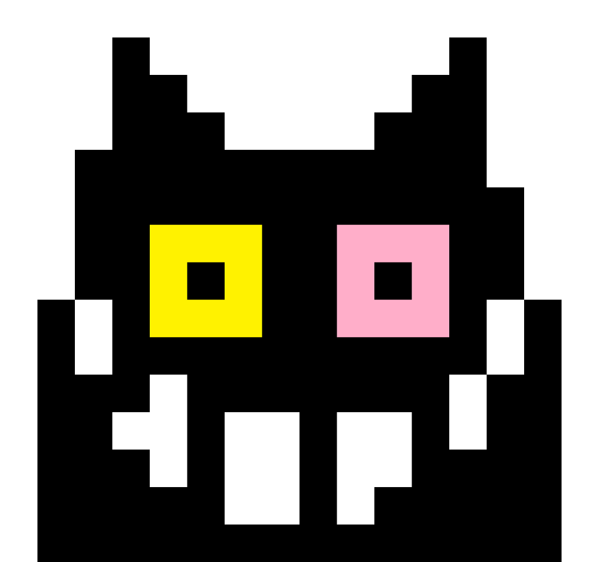

# farbzen

Hi there, I am Fabian, a DevOps Engineer with a love for software development!

I mostly tinker with NixOS, write Neovim plugins and over-engineer everything!

## NixOS Configuration

* **[core.nix](https://github.com/farbzen/core.nix)**: My personal NixOS configuration and dotfiles as a single flake.

## Neovim Plugins

| Project | Description |
| --- | --- |
| [pentatonic.nvim](https://github.com/farbzen/pentatonic.nvim) | A harmonic tone for every keystroke in Neovim |
| [tacho.nvim](https://github.com/farbzen/tacho.nvim) | A speedometer for your typing: words per minute, live and all-time |

## Nix Tooling

| Project | Description |
| --- | --- |
| [narf](https://github.com/farbzen/narf) | NixOS Advanced Rebuild Flake |
| [nurpkgs](https://github.com/farbzen/nurpkgs) | Nix User Repository with packages, NixOS modules, and overlays |

## Misc

- [mixedupmh](https://github.com/farbzen/mixedupmh): a randomizer for Monster Hunter Wilds that rolls monsters and weapons for your hunting party (Rust)
